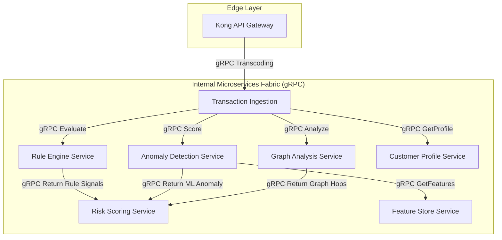

# API Contracts Specification: REST (OpenAPI 3.0) & Internal gRPC (Protobuf)

ShieldPay enforces strict contract-first design. External clients communicate via RESTful HTTP/JSON interfaces exposed by Kong API Gateway, while internal low-latency microservice communications run over high-performance **gRPC with Protocol Buffers v3**.

---

## 1. External RESTful API Summary (OpenAPI 3.0)

Exposed on port `443` through the API Gateway:

| Method | Endpoint | Description | Auth Required | Rate Limit (Tier 1 Merchant) | Response SLA |
| :--- | :--- | :--- | :--- | :--- | :--- |
| `POST` | `/api/v1/transactions` | Submits a live payment transaction for real-time fraud scoring. | Mutual TLS + API Key / Bearer JWT | 1,000 req/sec | < 100 ms |
| `GET` | `/api/v1/transactions/{id}/risk-score` | Retrieves cached fraud score, contributing signals, and decision. | Bearer JWT (Role: Analyst/Merchant) | 200 req/sec | < 15 ms |
| `GET` | `/api/v1/cases` | Paginated and filterable list of fraud investigation cases. | Bearer JWT (Role: Analyst/Supervisor) | 50 req/sec | < 150 ms |
| `PUT` | `/api/v1/cases/{id}/decision` | Analyst submits human-in-the-loop fraud case verdict. | Bearer JWT (Role: Analyst/Supervisor) | 20 req/sec | < 100 ms |
| `GET` | `/api/v1/rules` | Retrieves active fraud detection rules with versioning. | Bearer JWT (Role: RiskOfficer) | 20 req/sec | < 50 ms |
| `POST` | `/api/v1/rules` | Authors and submits a new candidate fraud detection rule. | Bearer JWT (Role: RiskOfficer) | 5 req/sec | < 100 ms |
| `GET` | `/api/v1/dashboard/metrics` | Fetches aggregated real-time fraud metrics, TPS, and alerts. | Bearer JWT (Role: Executive/Analyst) | 30 req/sec | < 30 ms |

---

## 2. Internal High-Speed gRPC Services (Protobuf v3)

Internal microservices interact exclusively using gRPC over HTTP/2 with mutual TLS:

### Key gRPC Service Interfaces:
1. **`RuleEngineService` (`rule_engine.proto`)**:
   - `rpc Evaluate(RuleEvaluationRequest) returns (RuleEvaluationResponse)`
   - *Deadline*: 25 ms. *Retry*: 1 retry with 5ms backoff.
2. **`AnomalyDetectionService` (`anomaly_detection.proto`)**:
   - `rpc Score(AnomalyScoreRequest) returns (AnomalyScoreResponse)`
   - *Deadline*: 20 ms. *Retry*: No retry (fail fast to fallback score).
3. **`GraphAnalysisService` (`graph_analysis.proto`)**:
   - `rpc AnalyseRelationships(GraphAnalysisRequest) returns (GraphAnalysisResponse)`
   - *Deadline*: 45 ms. *Retry*: No retry.
4. **`RiskScoringService` (`risk_scoring.proto`)**:
   - `rpc ComputeScore(RiskScoringRequest) returns (RiskScoringResponse)`
   - *Deadline*: 15 ms.
5. **`CustomerProfileService` (`customer_profile.proto`)**:
   - `rpc GetProfile(ProfileRequest) returns (ProfileResponse)`
   - `rpc UpdateProfile(UpdateProfileRequest) returns (UpdateProfileResponse)`
6. **`FeatureStoreService` (`feature_store.proto`)**:
   - `rpc GetFeatures(FeatureRequest) returns (FeatureResponse)`

---

## 3. Authentication & Authorization Architecture

- **Machine-to-Machine (M2M)**: External payment networks and merchant POS terminals authenticate via **OAuth 2.0 Client Credentials Grant** with short-lived RS256 JWT tokens (15-minute expiration) and API Keys passed in `X-API-Key`.
- **Role-Based Access Control (RBAC)**:
  - `fraud:analyst`: Permitted to view `/cases`, update case verdicts, and inspect transaction explanations.
  - `fraud:supervisor`: Permitted to reassign cases, approve high-value chargebacks, and simulate candidate rules.
  - `risk:officer`: Full authoring privileges on `/rules` and model challenger deployment triggers.
  - `auditor:regulatory`: Read-only access to `/audit` Merkle verification endpoints and RBI reporting streams.
