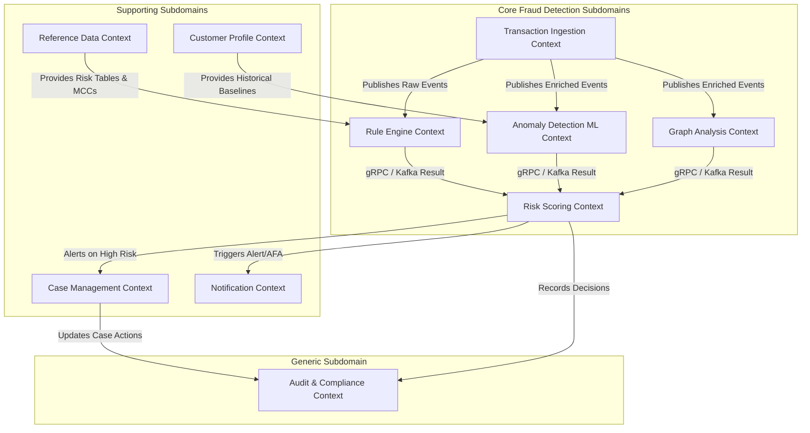

# Bounded Contexts, Service Decomposition & Domain Model

## 1. Domain-Driven Design (DDD) Bounded Contexts

Applying Domain-Driven Design (DDD) to the fraud detection ecosystem decomposes ShieldPay's complex domain into 10 cohesive Bounded Contexts, eliminating shared database locks and guaranteeing autonomous service evolution.

---

## 2. Service Decomposition Table

| # | Microservice Name | Bounded Context | Primary Responsibility | Tech Stack | Dedicated Datastore | Team Ownership (3-5 Eng) |
|---|-------------------|-----------------|------------------------|------------|---------------------|--------------------------|
| **1** | `transaction-ingestion-service` | Transaction Ingestion | Channel protocol translation (ISO 8583, REST, UPI), device enrichment, payload validation, publishing to Kafka `fraud.transactions.raw`. | Go / Gin / gRPC | PostgreSQL 16 (Timescale partition for raw tx ledger) | *Ingestion & Edge Team* |
| **2** | `rule-engine-service` | Fraud Rule Evaluation | Low-latency deterministic evaluation of 500+ dynamic business rules with in-memory caching and short-circuit execution. | Java 21 / Spring Boot 3 / GraalVM | Redis 7 (In-memory compiled rules & velocity counters) | *Rules & Policy Team* |
| **3** | `anomaly-detection-service` | Anomaly Detection | Supervised & unsupervised ML model inference (<10ms), real-time feature extraction, and drift monitoring. | Python 3.11 / FastAPI / ONNX Runtime | Feast Feature Store + Redis Cluster | *Data Science & ML Ops Team* |
| **4** | `graph-analysis-service` | Graph Analytics | Identification of organized fraud rings, multi-hop shared infrastructure, and triangulation topologies. | Java / Quarkus + Neo4j OGM | Neo4j Enterprise (Clustered graph db with GDS library) | *Graph Analytics Team* |
| **5** | `risk-scoring-service` | Risk Scoring | Signal aggregation (Rule + ML + Graph), composite scoring (0-1000), decision policy enforcement, and explainability generation. | Go / gRPC | Redis (Fast policy cache) + PostgreSQL (Decisions) | *Core Risk Engine Team* |
| **6** | `case-management-service` | Case Management | Human-in-the-loop analyst workbench, queue routing (round-robin/skill-based), evidence timeline, dispute & chargeback lifecycle. | TypeScript / Node.js / NestJS | PostgreSQL 16 (Relational state & workflows) | *Operations Tooling Team* |
| **7** | `notification-service` | Multi-Channel Notification | Multilingual alerting (SMS, Email, Push, Webhooks) with template rendering in 10 Indian regional languages + English. | Go / Goroutines worker pool | RabbitMQ (Local retry buffers) + Redis (Rate limit) | *Communications Team* |
| **8** | `audit-compliance-service` | Audit & Compliance | Cryptographic Merkle-tree hash-chained audit logging of all decisions, rule revisions, and regulatory FMR-1 generation. | Rust / Actix-web | Amazon QLDB / Immutable Postgres append-only log | *Governance & Security Team* |
| **9** | `customer-profile-service` | Customer Behavioral Profile | Aggregation and maintenance of customer historical features (spending velocity, home/work geofences, device inventory). | Python / FastAPI | Cassandra 4.0 / ScyllaDB + Redis cache | *Customer Data Platform Team* |
| **10** | `reference-data-service` | Reference Data & Watchlists | Fast lookup for MCC risks, BIN tables, OFAC/RBI watchlists, country risk indices, currency exchange rates. | Go / gRPC | Redis Cluster (Replicated in-memory cache) | *Reference Data Team* |

---

## 3. Context Mapping & Integration Patterns

1. **Customer-Supplier**:
   - `transaction-ingestion-service` (Supplier) upstream feeds `rule-engine-service` and `anomaly-detection-service` (Customers). Upstream commits to a strict contract via Protobuf schemas in Confluent Schema Registry.
2. **Conformist**:
   - `notification-service` acts as a Conformist to the event model emitted by `risk-scoring-service` on topic `fraud.decisions`.
3. **Anti-Corruption Layer (ACL)**:
   - Built inside the `transaction-ingestion-service` edge connectors to bridge legacy ISO 8583 financial messages from bank mainframe switches into modern JSON/Protobuf canonical events without polluting microservice domain logic.
4. **Shared Kernel**:
   - The shared Proto domain contracts (`common.proto`), encapsulating foundational value objects (`TransactionId`, `CardNumberHash`, `RiskTier`, `CurrencyAmount`, `ChannelType`).
