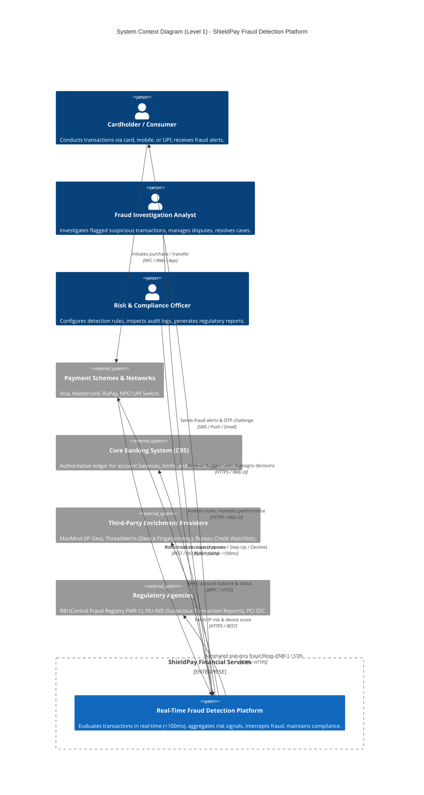
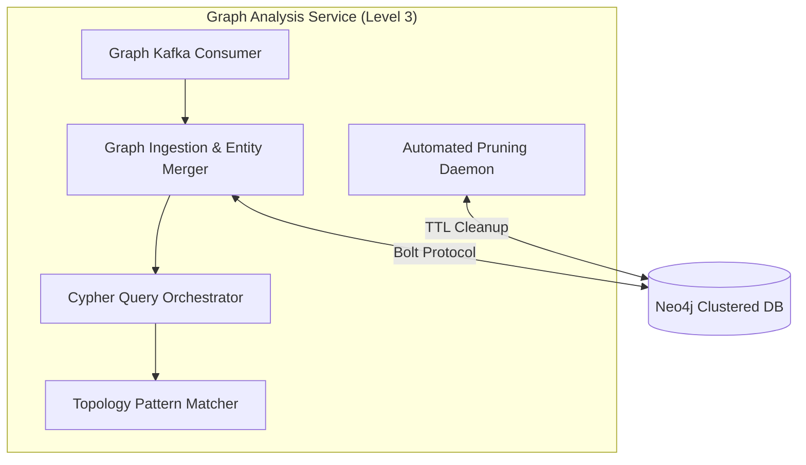
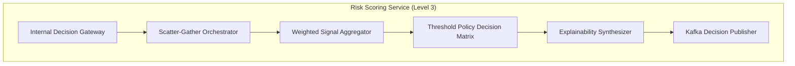

# C4 Architectural Documentation (Levels 1, 2, and 3)

The C4 model (Context, Containers, Components, Code) provides a hierarchical and disciplined approach to documenting ShieldPay's Real-Time Fraud Detection Platform.

---

## Level 1: System Context Diagram

The System Context diagram illustrates the platform's position within the global and Indian financial ecosystem, highlighting external human actors and external banking networks.



---

## Level 2: Container Diagram

The Container diagram zooms into the platform boundaries, detailing each independently deployable microservice, datastore, event broker, and API gateway.

```mermaid
C4Container
    title Container Diagram (Level 2) - ShieldPay Microservices Platform

    Container(api_gateway, "API Gateway", "Kong / Envoy", "Edge reverse proxy, TLS termination, JWT validation, tiered rate limiting.")
    Container(kafka, "Message Broker", "Apache Kafka 3.6", "Distributed event backbone with 8+ topics partitioned by card_number_hash.")

    Container(ingestion_svc, "Transaction Ingestion Service", "Go / Gin", "Validates, normalises payloads, enriches device/IP data, publishes to Kafka.")
    Container(rule_engine_svc, "Rule Engine Service", "Java 21 / Spring Boot", "Evaluates 500+ deterministic & temporal rules using in-memory sliding windows.")
    Container(anomaly_svc, "Anomaly Detection Service", "Python / FastAPI / ONNX", "Real-time ML inference (XGBoost / Isolation Forest) with sub-10ms latency.")
    Container(graph_svc, "Graph Analysis Service", "Java / Quarkus", "Traverses multi-hop entity relationships and detects organized fraud rings.")
    Container(risk_scoring_svc, "Risk Scoring Service", "Go / gRPC", "Aggregates rule, ML, and graph signals into composite risk score (0-1000).")
    Container(case_mgmt_svc, "Case Management Service", "Node.js / NestJS", "Analyst workflow, case queues, dispute tracking, chargeback coordination.")
    Container(notification_svc, "Notification Service", "Go Workers", "Dispatches multi-channel alerts in 10 Indian languages + English.")
    Container(audit_svc, "Audit & Compliance Service", "Rust", "Maintains immutable Merkle-tree hash-chained audit log for all actions.")
    Container(profile_svc, "Customer Profile Service", "Python / FastAPI", "Maintains spending profiles, preferred merchants, and travel histories.")
    Container(ref_data_svc, "Reference Data Service", "Go", "Provides MCC risk scores, BIN data, and watchlists.")

    ContainerDb(redis_cluster, "In-Memory Cache & Velocity Store", "Redis 7 Cluster", "Velocity sliding windows, rate limit counters, rule caches.")
    ContainerDb(postgres_ledger, "Transactional Ledger", "PostgreSQL 16 + TimescaleDB", "ACID transactions, transaction ledger, and case state.")
    ContainerDb(neo4j_cluster, "Fraud Graph Database", "Neo4j Enterprise", "Entity nodes and relationship edges for fraud ring detection.")
    ContainerDb(audit_ledger, "Immutable Audit Store", "Amazon QLDB / Merkle Log", "Append-only cryptographically chained audit events.")

    Rel(api_gateway, ingestion_svc, "Routes transaction requests", "gRPC / REST")
    Rel(ingestion_svc, kafka, "Publishes raw & enriched transactions", "Kafka Producer")
    Rel(kafka, rule_engine_svc, "Streams transactions", "Kafka Consumer")
    Rel(kafka, anomaly_svc, "Streams transactions", "Kafka Consumer")
    Rel(kafka, graph_svc, "Streams transactions", "Kafka Consumer")
    Rel(rule_engine_svc, redis_cluster, "Reads/writes sliding windows", "Redis Protocol")
    Rel(anomaly_svc, redis_cluster, "Fetches online ML features", "Redis Protocol")
    Rel(graph_svc, neo4j_cluster, "Executes Cypher traversals", "Bolt Protocol")
    Rel(risk_scoring_svc, kafka, "Publishes fraud.decisions", "Kafka Producer")
    Rel(kafka, case_mgmt_svc, "Consumes fraud alerts", "Kafka Consumer")
    Rel(kafka, notification_svc, "Consumes notification requests", "Kafka Consumer")
    Rel(kafka, audit_svc, "Consumes all decision & rule events", "Kafka Consumer")
    Rel(audit_svc, audit_ledger, "Appends cryptographic record", "Append-only")
    Rel(case_mgmt_svc, postgres_ledger, "Reads/writes cases", "SQL")
```



---

## Level 3: Component Diagrams for 4 Core Microservices

### 1. Rule Engine Service Component Diagram
Decomposes `rule-engine-service` into its internal modular blocks:
- **Rule Parser**: Parses YAML rule definitions into internal AST condition trees.
- **Rule Cache**: Thread-safe in-memory cache of pre-compiled rules with invalidation hooks.
- **Condition Evaluator**: Evaluates boolean predicates against transaction attributes.
- **Temporal Aggregator**: Computes windowed aggregations via Redis sorted sets.
- **Action Executor**: Formulates score adjustment deltas, triggers, and tags.
- **Rule Management API**: REST endpoints for authoring, versioning, and deploying rules.

```mermaid
graph TD
    subgraph RuleEngine["Rule Engine Service (Level 3)"]
        API[Rule Management REST Controller]
        PARSER[Rule Parser & YAML Validator]
        CACHE[In-Memory Compiled Rule Cache]
        EVAL[Condition Evaluator Engine]
        TEMP[Temporal Aggregator (Sliding Window)]
        EXEC[Action & Delta Score Executor]
        METRIC[Prometheus Metrics Exporter]
    end

    API --> PARSER
    PARSER --> CACHE
    CACHE --> EVAL
    EVAL --> TEMP
    EVAL --> EXEC
    EXEC --> METRIC
    TEMP <-->|Atomic ZSET Queries| REDIS[(Redis Velocity Cluster)]
```

### 2. Anomaly Detection Service Component Diagram
Decomposes `anomaly-detection-service`:
- **Feature Pipeline**: Transforms raw transaction payloads into dense numeric vectors.
- **Feature Store Client**: Asynchronously fetches cardholder 30/60/90-day historical aggregates from Redis.
- **ONNX Inference Session**: Low-latency multi-threaded ONNX runtime executing XGBoost & Autoencoder models.
- **SHAP Explainer Module**: Computes real-time TreeSHAP feature contributions for the top 5 anomalies.
- **Drift Monitor**: Calculates hourly Population Stability Index (PSI) and Kolmogorov-Smirnov statistics.

```mermaid
graph TD
    subgraph AnomalyDetection["Anomaly Detection Service (Level 3)"]
        GRPC_SRV[gRPC Scoring Server]
        FEAT_ENG[Feature Engineering Transformer]
        FEAT_CLI[Redis Feature Store Client]
        ONNX_RT[ONNX Runtime Engine (XGBoost/IForest)]
        SHAP[SHAP Feature Attribution Module]
        DRIFT[Drift Detection Monitor (PSI & KS)]
    end

    GRPC_SRV --> FEAT_ENG
    FEAT_ENG <--> FEAT_CLI
    FEAT_ENG --> ONNX_RT
    ONNX_RT --> SHAP
    ONNX_RT --> DRIFT
```

### 3. Graph Analysis Service Component Diagram
Decomposes `graph-analysis-service`:
- **Graph Stream Consumer**: Consumes `transactions.enriched` and extracts entity nodes and edges.
- **Graph Ingestion Worker**: Asynchronously updates Neo4j via Cypher transactions with node merge logic.
- **Query Execution Engine**: Dispatches Cypher pattern queries for ring detection, PageRank, and shortest paths.
- **Topology Template Matcher**: Matches subgraphs against known fraud topologies (triangulation, mule nets).
- **Pruning Scheduled Worker**: Daily background job archiving relationships older than 180 days.



### 4. Risk Scoring Service Component Diagram
Decomposes `risk-scoring-service`:
- **gRPC Evaluator Client**: Scatter-gathers evaluation calls to Rule Engine, Anomaly Detection, and Graph Analysis.
- **Aggregation Engine**: Executes configurable aggregation algorithms (Weighted Linear, Max-Signal, Bayesian).
- **Decision Matrix**: Evaluates composite scores (0-1000) against threshold policies to determine action.
- **Explainability Synthesizer**: Merges rule tags, SHAP feature attributions, and graph hops into an audit-ready summary.
- **Decision Kafka Publisher**: Publishes final decision to `fraud.decisions` topic with guaranteed delivery.


