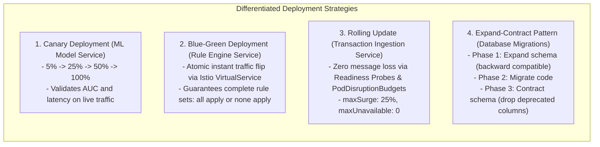
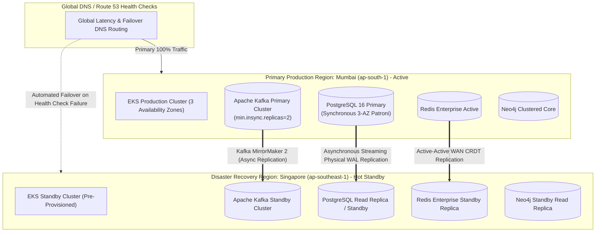

# Deployment Strategy, Multi-Region Disaster Recovery & Chaos Engineering

ShieldPay enforces automated, zero-downtime deployments with a resilient multi-region infrastructure designed to guarantee **RPO < 1 minute** and **RTO < 5 minutes** on the critical transaction processing path.

---

## 1. Differentiated Deployment Strategy Per Service Tier

---

## 2. Multi-Region Active-Passive Disaster Recovery Topology

### RPO & RTO Targets by Tier:
- **Tier 1 (Critical Path: Ingestion, Rules, Risk Scoring)**:
  - Intra-region: \(\text{RPO} = 0\), \(\text{RTO} < 10\text{ seconds}\).
  - Cross-region disaster failover: \(\text{RPO} \le 30\text{ seconds}\), \(\text{RTO} \le 4\text{ minutes}\).
- **Tier 2 (Case Management, Notifications, Analytics)**:
  - \(\text{RPO} \le 5\text{ minutes}\), \(\text{RTO} \le 20\text{ minutes}\).
- **Tier 3 (Batch Reporting, Historical Archive)**:
  - \(\text{RPO} \le 1\text{ hour}\), \(\text{RTO} \le 2\text{ hours}\).

---

## 3. Automated Disaster Recovery Failover Runbook

1. **Detection (0:00 - 0:45)**: Route 53 health check probes fail 3 consecutive attempts (15s intervals) against Mumbai API Gateway `/healthz`.
2. **Authorization (0:45 - 1:30)**: Automated Alertmanager webhook notifies Incident Commander; if no override within 60s, automated failover triggers.
3. **Execution (1:30 - 3:00)**:
   - Promote Singapore PostgreSQL standby replica to primary (`patroni-ctl switchover`).
   - Stop MirrorMaker 2 and switch Singapore Kafka consumer groups from mirror offsets to active offsets using Confluent offset translation.
   - Point Route 53 DNS records to Singapore API Gateway Load Balancer.
4. **Verification (3:00 - 4:15)**: Automated synthetic test transaction dispatched through Singapore gateway; verifies HTTP 200 and valid risk decision.
5. **Rollback Procedure**: When Mumbai power/network restores, re-sync delta WAL from Singapore back to Mumbai before reversing Route 53 weights.

---

## 4. Five Chaos Engineering Failure Experiments

| Exp # | Experiment Name | Failure Injected | Expected System Behavior | Validation Metric & Detecting Dashboard |
| :---: | :--- | :--- | :--- | :--- |
| **1** | **Pod Random Termination** | `chaos-mesh` terminates 50% of `rule-engine-service` pods during 5,000 TPS load. | PodDisruptionBudget ensures minAvailable=4. HPA spins up replacement pods within 18 seconds. Zero dropped requests (5xx < 0.01%). | Grafana Dashboard 1 (5xx rate remains below SLA). |
| **2** | **Network Latency Injection** | Injects 200ms latency between `risk-scoring-service` and `graph-analysis-service`. | gRPC deadline of 45ms triggers in Risk Scoring. Graph service short-circuits; transaction proceeds with safety penalty. Pipeline SLA < 100ms maintained. | Grafana Dashboard 1 (p99 latency < 100ms); Dashboard 2 (Graph Fallback counter increments). |
| **3** | **Kafka Broker Kill** | Kills Partition Leader broker in the 3-node primary Kafka cluster. | Kafka controller elects new leader within 1.8 seconds. Producer retries automatically via buffer; zero message loss (`acks=all`). | Kafka lag graph in Dashboard 4; transient lag recovers to < 100 in 60s. |
| **4** | **Redis Master Cache Failure** | Kills Redis Master node storing velocity sliding windows. | Redis Sentinel / Cluster promotes replica in < 2.5 seconds. Rule engine falls back to local in-memory LRU cache for 3 seconds. | Redis master state metric (`redis_up`); 0 failed transaction authorizations. |
| **5** | **PostgreSQL Primary Failover** | Simulates hard crash of active PostgreSQL primary database. | Patroni initiates Raft leader election; synchronous standby promoted to primary in < 8 seconds. Ingestion buffering prevents transaction drops. | Patroni failover audit event; database write latency recovers within 10 seconds. |
