# Event Storming Specification: Domain Events, Commands, & Aggregates

This document catalogs the complete Event Storming output for ShieldPay's Real-Time Fraud Detection Platform, specifying **55 distinct domain events**, associated commands, aggregate roots, policies, and read models spanning the full transaction lifecycle.

---

## 1. Domain Event Lifecycle Flow

```mermaid
flowchart LR
    subgraph IngestionStage["1. Ingestion & Enrichment"]
        E1[TransactionReceived] --> E2[PayloadValidated]
        E2 --> E3[DeviceFingerprinted]
        E3 --> E4[GeoLocated]
        E4 --> E5[TransactionEnriched]
    end

    subgraph DetectionStage["2. Parallel Detection"]
        E5 --> E6[RuleEvaluationStarted]
        E5 --> E7[MLScoringStarted]
        E5 --> E8[GraphTraversalStarted]
        E6 --> E9[RuleTriggered]
        E7 --> E10[AnomalyScoreComputed]
        E8 --> E11[GraphRingDetected]
    end

    subgraph DecisionStage["3. Risk Scoring & Policy"]
        E9 & E10 & E11 --> E12[RiskSignalsAggregated]
        E12 --> E13[RiskDecisionComputed]
        E13 --> E14[TransactionApproved]
        E13 --> E15[StepUpAuthRequested]
        E13 --> E16[TransactionDeclined]
    end

    subgraph OperationsStage["4. Operations & Case Management"]
        E16 --> E17[FraudAlertRaised]
        E17 --> E18[FraudCaseCreated]
        E18 --> E19[CardTemporarilyFrozen]
        E19 --> E20[AnalystAssigned]
        E20 --> E21[CaseResolved]
    end
```

---

## 2. Complete 55 Domain Events Catalog

### Aggregate: `Transaction` (Ingestion & Ledger)
1. `TransactionReceived`: Raw transaction payload ingested from payment channel.
2. `PayloadValidated`: Payload passed schema and checksum validation.
3. `PayloadValidationFailed`: Malformed or unauthorized transaction rejected.
4. `DeviceFingerprinted`: Device attributes parsed and hashed into unique fingerprint.
5. `GeoLocated`: IP address resolved to city, country, ASN, and proxy status.
6. `TransactionEnriched`: Normalized transaction enriched with customer baseline and device data.
7. `TransactionLedgerRecorded`: Transaction persisted to PostgreSQL transactional ledger.
8. `DuplicateTransactionDetected`: Idempotency key match identified duplicate submission.
9. `TransactionSettled`: Merchant funds cleared and settled successfully.
10. `TransactionReversed`: Settlement canceled or refunded by merchant.

### Aggregate: `RuleEngine` (Deterministic Rules)
11. `RuleSetLoaded`: Compiled rules loaded into in-memory execution cache.
12. `RuleEvaluationStarted`: Initiated rule chain evaluation for transaction.
13. `VelocityThresholdExceeded`: Cardholder velocity breached temporal count/sum limits.
14. `HighRiskMCCDetected`: Transaction at gambling, crypto, or cash-equivalent merchant.
15. `ImpossibleTravelDetected`: Consecutive transactions breached physical travel velocity (>800 km/h).
16. `WatchlistMatchDetected`: Entity matched OFAC, RBI, or internal fraud list.
17. `RuleTriggered`: Individual rule condition evaluated to true.
18. `RuleEvaluationCompleted`: All active rules completed with final rule score and tags.
19. `RuleEvaluationTimedOut`: Evaluation exceeded deadline; fallback applied.

### Aggregate: `AnomalyModel` (Machine Learning)
20. `FeaturesExtracted`: Input vector extracted from online feature store.
21. `ModelInferenceStarted`: ONNX runtime commenced prediction scoring.
22. `AnomalyScoreComputed`: Supervised and unsupervised models produced composite anomaly score.
23. `SHAPAttributionsGenerated`: Top 5 feature explanations computed via TreeSHAP.
24. `ModelInferenceTimedOut`: ML service breached SLA; default prior score emitted.
25. `FeatureDriftDetected`: Population Stability Index (PSI) exceeded 0.25 threshold.
26. `PredictionDriftDetected`: Kolmogorov-Smirnov test identified scoring shift.
27. `ModelRetrainingTriggered`: Automated workflow initiated to retrain model weights.
28. `ChallengerModelEvaluated`: Shadow candidate model scored alongside champion.
29. `ChampionModelPromoted`: Candidate model promoted to active production serving.

### Aggregate: `FraudGraph` (Graph Analysis)
30. `GraphNodeUpserted`: Entity node (Card, Device, IP, Account) merged into Neo4j.
31. `GraphEdgeCreated`: Relationship edge (`TRANSACTED_WITH`, `SHARED_DEVICE`) created.
32. `GraphTraversalStarted`: Query engine initiated multi-hop neighbor search.
33. `FraudRingDetected`: Louvain community detection identified tight cluster of synthetic accounts.
34. `BridgeMuleDetected`: Betweenness centrality flagged high-transit laundering account.
35. `HighPageRankEntityFlagged`: Shared device or IP identified with abnormally high connection degree.
36. `TriangulationPatternMatched`: Subgraph topology matched 3-party e-commerce triangulation.
37. `GraphPruningCompleted`: Graph relationship edges older than 180 days archived and evicted.

### Aggregate: `RiskDecision` (Composite Decision)
38. `RiskSignalsAggregated`: Rule, ML, and Graph outputs combined via weighted formula.
39. `RiskDecisionComputed`: Composite score (0-1000) assigned with action classification.
40. `TransactionApproved`: Score 0-199; transaction cleared with low risk.
41. `StepUpAuthRequested`: Score 200-599; challenge OTP or biometric triggered.
42. `StepUpAuthSucceeded`: Customer correctly entered challenge credential.
43. `StepUpAuthFailed`: Customer failed or expired challenge credential.
44. `TransactionDeclined`: Score 800-1000 or critical rule triggered; authorization denied.
45. `DecisionExplainabilityGenerated`: Human-readable rationale assembled for audit.

### Aggregate: `FraudCase` (Case Management & Operations)
46. `FraudAlertRaised`: Transaction score >= 600 or hard-stop rule fired.
47. `FraudCaseCreated`: Investigation ticket created in Case Management Service.
48. `CardTemporarilyFrozen`: Card frozen via Core Banking API pending review.
49. `AnalystAssigned`: Case assigned to human investigator via round-robin / skill routing.
50. `CaseEvidenceAppended`: Notes, customer call logs, or chargeback files attached.
51. `CaseFraudConfirmed`: Analyst verified transaction was authentic fraud.
52. `CaseFalsePositiveMarked`: Analyst cleared transaction as legitimate customer activity.
53. `CardPermanentlyBlocked`: Card canceled and re-issue ordered.
54. `ChargebackInitiated`: Dispute filed through card network interchange.
55. `RBIFraudReportGenerated`: Regulatory FMR-1 return synthesized for RBI submission.

---

## 3. Aggregate Boundaries & Policy Definitions

- **Aggregate 1: `TransactionAggregate`**: Root entity managing raw ingestion, state transitions (Pending -> Approved / Declined), and ledger immutability.
- **Aggregate 2: `RuleDefinitionAggregate`**: Governs rule authoring, versioning, AST syntax validation, and lifecycle transitions.
- **Aggregate 3: `FraudCaseAggregate`**: Coordinates human investigation workflows, analyst claims, case decisions, and dispute lifecycle.
- **Aggregate 4: `AuditJournalAggregate`**: Manages the append-only cryptographic Merkle tree, generating sequential hashes and proofs.

### Event Storming Reactive Policies:
- **Policy 1 (`OnTransactionEnriched -> StartDetection`)**: Whenever `TransactionEnriched` fires, scatter requests in parallel to Rule Engine, Anomaly Detection, and Graph Analysis.
- **Policy 2 (`OnFraudAlertRaised -> FreezeCardAndCreateCase`)**: Whenever `FraudAlertRaised` occurs with severity high/critical, invoke Saga Orchestrator to freeze card in Core Banking and open an urgent P1 Case.
- **Policy 3 (`OnCaseFraudConfirmed -> UpdateWatchlistsAndGraph`)**: When an analyst confirms fraud, automatically add device fingerprint and card hash to high-risk watchlists and mark graph node as `CONFIRMED_FRAUD`.
