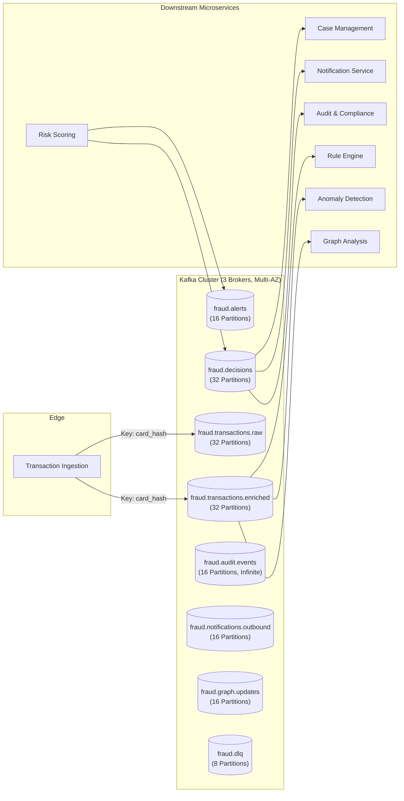

# Apache Kafka Topology, Topic Architecture & Dead Letter Queue (DLQ) Strategy

Apache Kafka 3.6 serves as the distributed, event-driven streaming backbone for ShieldPay's Real-Time Fraud Detection Platform.

---

## 1. Topic Topology & Partitioning Strategy

### Partitioning Key: `card_number_hash`
To guarantee strict sequential ordering of transactions and events for any given payment card, all transaction-related topics are keyed by `card_number_hash` (`SHA-256(PAN + Salt)`). This ensures:
1. All transactions for a given card are guaranteed to land on the exact same partition.
2. A single consumer thread in a consumer group processes transactions for that card strictly in order of emission, preventing race conditions during rapid velocity evaluation.

---

## 2. Comprehensive Topic Specification Table

| # | Topic Name | Partition Count | Replication Factor | Retention Policy | Partition Key Strategy | Producing Services | Consuming Services (Consumer Group ID) |
|---|------------|-----------------|--------------------|------------------|------------------------|--------------------|----------------------------------------|
| **1** | `fraud.transactions.raw` | 32 | 3 (min.isr=2) | 30 days (`compact,delete`) | `card_number_hash` | `transaction-ingestion-service` | `cg-enrichment-workers`, `cg-raw-ledger-archiver` |
| **2** | `fraud.transactions.enriched` | 32 | 3 (min.isr=2) | 14 days (`delete`) | `card_number_hash` | `transaction-ingestion-service` | `cg-rule-engine-evaluators`, `cg-anomaly-scorers`, `cg-graph-sync` |
| **3** | `fraud.alerts` | 16 | 3 (min.isr=2) | 60 days (`delete`) | `transaction_id` | `risk-scoring-service` | `cg-case-management-creators`, `cg-security-soc` |
| **4** | `fraud.decisions` | 32 | 3 (min.isr=2) | 90 days (`delete`) | `card_number_hash` | `risk-scoring-service` | `cg-notification-dispatchers`, `cg-analytics-cqrs`, `cg-audit-capture` |
| **5** | `fraud.audit.events` | 16 | 3 (min.isr=2) | **Infinite (`retention.ms=-1`)** | `actor_id` or `entity_id`| All services | `cg-audit-merkle-writer`, `cg-rbi-compliance-stream` |
| **6** | `fraud.notifications.outbound` | 16 | 3 (min.isr=2) | 7 days (`delete`) | `customer_id` | `risk-scoring-service`, `case-management-service` | `cg-notification-senders` |
| **7** | `fraud.graph.updates` | 16 | 3 (min.isr=2) | 7 days (`delete`) | `entity_id` | `transaction-ingestion-service`, `case-management` | `cg-graph-database-sync` |
| **8** | `fraud.dlq` | 8 | 3 (min.isr=2) | 90 days (`delete`) | `original_topic` + `partition` | All Kafka consumers (on unrecoverable failure) | `cg-dlq-inspector`, `cg-ops-debugger` |

---

## 3. Schema Registry Configuration & Compatibility

- **Registry**: Confluent Schema Registry (clustered, high availability).
- **Serialization Format**: Protocol Buffers v3 and Apache Avro.
- **Compatibility Modes**:
  - `fraud.transactions.raw` & `fraud.decisions`: **`BACKWARD`** compatibility (consumers on older versions can safely read new payloads where new fields are optional).
  - `fraud.audit.events`: **`FULL`** compatibility (ensures both old and new consumers can read old and new events without data loss, satisfying strict regulatory mandates).

---

## 4. Dead Letter Queue (DLQ) & Poison Message Architecture

When a consumer encounters a malformed payload or an unrecoverable business logic exception:
1. **Exponential Retry with Jitter**: The consumer performs up to 3 immediate retries with exponential backoff (100ms, 500ms, 2000ms).
2. **DLQ Routing**: If retries are exhausted, the consumer wraps the raw payload with diagnostic metadata and publishes to `fraud.dlq`:
   - `original_topic`
   - `original_partition`
   - `original_offset`
   - `exception_class`
   - `error_message`
   - `stack_trace`
   - `timestamp`
3. **Commit & Alert**: The consumer commits its offset on the source partition to unblock the partition for subsequent transactions, while firing a P2 Prometheus metric alert: `kafka_consumer_dlq_routed_total`.
4. **DLQ Reprocessor**: An automated operational CLI tool allows operators to inspect poison messages in `fraud.dlq`, apply schema corrections, and replay them to the original topic.
