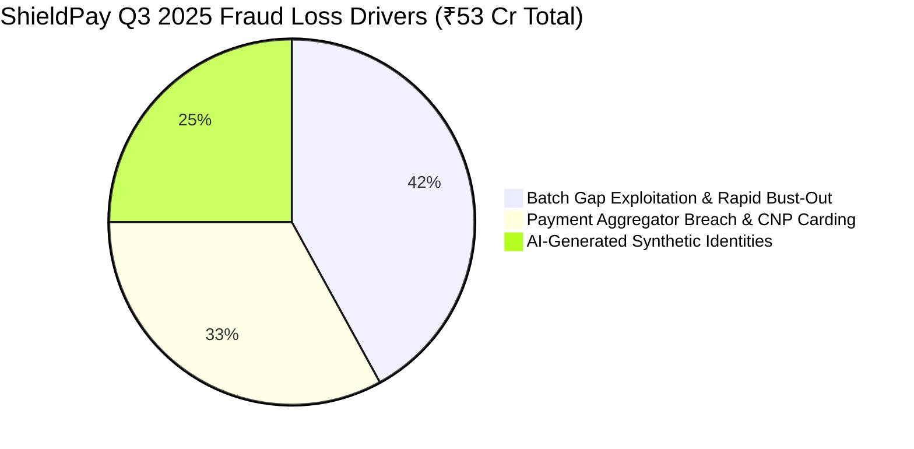
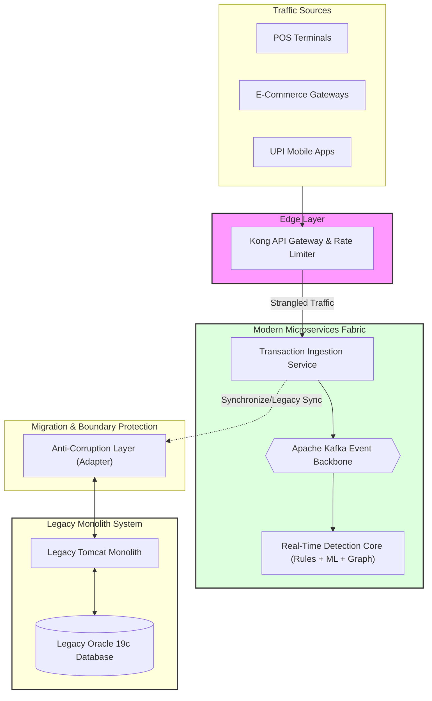

# Legacy Monolith Analysis & The Q3 2025 Fraud Crisis

## 1. Executive Summary & Starting State

**Company Profile**: ShieldPay Financial Services is a mid-tier credit card issuer and payment facilitator processing **2.4 million transactions per day** across India, Southeast Asia, and the Middle East, with peak traffic reaching **1,800 Transactions Per Second (TPS)** during festive seasons (Diwali, Great Indian Festival).

**Monolithic Legacy Architecture**:
- **Codebase**: Built originally in 2012, running a 1.2 million line monolithic Java application (`shieldpay-core.war`) deployed across 8 bare-metal Hewlett-Packard blade servers in a co-located tier-3 data centre in Mumbai.
- **Application Server**: Apache Tomcat 8.5 on Red Hat Enterprise Linux 7.
- **Rule Engine**: Over 500 fraud validation rules hard-coded directly in monolithic Java switch-case statements and deeply nested if-else blocks. Adding, altering, or removing a rule requires code recompilation, manual regression testing, and an scheduled 4-hour maintenance window on Saturday nights.
- **Database**: Single monolithic Oracle Database 19c Enterprise Edition instance (45 TB on SAN storage) hosting customer profiles, financial transaction ledgers, authorization logs, dispute records, and reporting data on a shared physical storage volume.
- **Machine Learning Integration**: Batch-mode scoring via a cron job running every 15 minutes that executes a Python script pulling the latest 15 minutes of transactions from Oracle and running inference against a static Logistic Regression model trained 6 months prior.
- **Persistence & Availability**: No active-passive cross-region disaster recovery replication, no automated database failover, and zero read-replicas. All read-heavy reporting queries run against the master transactional tables, resulting in 3 to 12-second lock contentions during business hours.

---

## 2. Architectural Pain Points & Vulnerabilities

| Area | Monolithic Pain Point | Business & Operational Impact |
| :--- | :--- | :--- |
| **Coupling & Blast Radius** | Single process namespace. Reporting queries share memory and connection pools with core payment authorization paths. | An expensive end-of-month reconciliation query frequently locks database tables, inducing timeouts on live card checkout flows. |
| **Deployment Cadence** | Monolithic build takes 45 minutes; deployment requires scheduled downtime (4-hour weekly maintenance window). | Incapable of hot-fixing fraud rules in response to active cyber attacks. Fraudsters exploit hours/days of rule immobility. |
| **Batch ML Scoring Window** | 15-minute cron execution delay creates a predictable 15-minute vulnerability window. | Fraudsters reverse-engineer the batch interval, initiating and completing multi-transaction bust-outs within 12 minutes before detection flags trigger. |
| **Relational Model for Networks** | Storing relationship graphs (cards, accounts, devices, IPs) in relational Oracle tables with 8-way SQL `JOIN`s. | Complex fraud ring discovery queries time out after 30 seconds or trigger high CPU load, making real-time ring detection impossible. |
| **Horizontal Scalability** | Only vertical scaling is supported (adding RAM/CPU to bare-metal servers). | The platform cannot elastically scale during shopping festival surges, leading to transaction drop-offs and lost merchant revenue. |

---

## 3. The Q3 2025 Fraud Crisis: Root Cause Analysis

In Q3 2025, ShieldPay experienced a catastrophic **340% increase in fraud incidents**, with quarterly fraud losses skyrocketing from **₹12 crore INR to ₹53 crore INR**, accompanied by a spike in the False Positive Rate (FPR) from **0.3% to 2.1%**.

### Threat 1: AI-Generated Synthetic Identity Ring
- **Modus Operandi**: Fraud syndicates utilized Generative AI tools (GANs, LLMs, DeepFake Video KYC generators) to synthesize thousands of synthetic identities with algorithmically valid Aadhaar checksum numbers, realistic physical addresses in metropolitan high-rises, and spoofed biometric video KYC.
- **The Failure**: The monolith treated each account in isolation. Because the synthetic accounts systematically paid small utility bills on time for 90 days, their customer credit scores were elevated. On day 91, coordinated bust-out transactions drained ₹13.25 crore across 450 accounts in 4 hours. Because the monolith lacked graph analysis, it failed to detect that all 450 identities shared only 8 device fingerprints and 4 common IP subnets.

### Threat 2: Third-Party Payment Aggregator Data Breach
- **Modus Operandi**: An external payment aggregator partnering with ShieldPay merchants was compromised, leaking 12 million card numbers, expiration dates, and CVVs on the dark web.
- **The Failure**: Carders initiated high-frequency enumeration attacks (testing 10,000 cards per minute with ₹10–₹50 micro-charges). Because the monolith's rate limiting was global and primitive (no per-merchant or per-IP token bucket in Redis), the attacks overwhelmed transaction processing threads and led to automated approval of subsequent large-value consumer electronics purchases.

### Threat 3: Exploitation of the 15-Minute Batch Scoring Gap
- **Modus Operandi**: Sophisticated fraud rings discovered that transactions were not scored in real-time by ML models, but rather queued in Oracle and evaluated at `:00`, `:15`, `:30`, and `:45` of every hour.
- **The Failure**: Attackers timed automated script attacks to fire at `:01`. Over the subsequent 13 minutes, 15 to 25 rapid transactions of ₹40,000 to ₹95,000 were completed per card before the 15-minute cron triggered. By the time the batch model flagged the card, the funds had been cash-withdrawn or laundered via cryptocurrency vouchers.

---

## 4. Decomposing the Monolith via the Strangler Fig Pattern

To transition from the vulnerable legacy architecture to an event-driven microservices platform without risking service disruption, ShieldPay adopts the **Strangler Fig Pattern** supported by an **Anti-Corruption Layer (ACL)**.

### Migration Phases:
1. **Phase 1 (Shadow Mode)**: Transaction Ingestion microservice is deployed behind the API gateway. It replicates incoming transaction requests into Kafka while proxying calls through the Anti-Corruption Layer to the legacy monolith.
2. **Phase 2 (Parallel Scoring Evaluation)**: The new Rule Engine, Anomaly Detection ML, and Graph Analysis microservices consume from Kafka and compute risk scores in real-time (< 100ms). Scores are logged and compared against legacy decisions for 30 days.
3. **Phase 3 (Active Interception)**: Real-time Risk Scoring takes ownership of the authorization path (`POST /api/v1/transactions`), returning deterministic allow/challenge/decline decisions immediately.
4. **Phase 4 (Monolith Retirement)**: Case management, notifications, customer profiles, and audit services are carved out one by one into independent microservices, leaving the legacy Oracle instance to be decommissioned.
