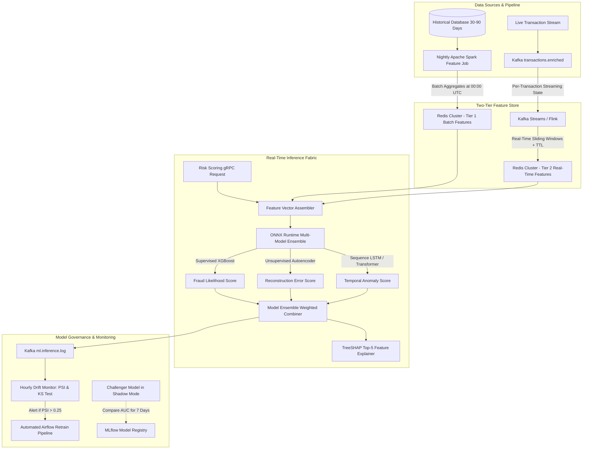

# Machine Learning Serving & Anomaly Detection Architecture

ShieldPay's Machine Learning detection layer operates in parallel with the deterministic rule engine, detecting evolving, zero-day, and non-linear fraud patterns with strict **sub-10ms inference latency**.

---

## 1. Multi-Model Ensemble Architecture

To ensure high recall without sacrificing precision, ShieldPay ensembles three distinct model architectures:
1. **Supervised Gradient Boosted Trees (XGBoost / LightGBM)**:
   - Trained on 12 months of historical labelled card transactions (reconciled against confirmed fraud and chargebacks).
   - Highly performant for tabular transaction features (amount, MCC, velocity, distance).
   - Produces calibrated probability score \(P(\text{Fraud} \mid X) \in [0, 1]\).
2. **Unsupervised Deep Autoencoder**:
   - Neural network trained exclusively on legitimate historical cardholder behavior to reconstruct normal baseline patterns.
   - For an incoming feature vector \(x\), the model computes reconstructed output \(\hat{x}\). The Mean Squared Error (Reconstruction Loss) \(L = \|x - \hat{x}\|^2\) measures anomaly divergence, identifying novel zero-day attack vectors that supervised models have never encountered.
3. **Sequence Deep Learning Model (Bi-LSTM / Mini-Transformer)**:
   - Evaluates the sequential order of the last 10 cardholder events (logins, password changes, balance queries, micro-charges).
   - Successfully flags credential stuffing and card testing enumeration patterns.

### Ensemble Blending Formula:
$$\text{MLCompositeScore} = w_1 \cdot \text{Score}_{\text{XGBoost}} + w_2 \cdot \text{Score}_{\text{Autoencoder}} + w_3 \cdot \text{Score}_{\text{Sequence}}$$
*(Default weights: \(w_1 = 0.55\), \(w_2 = 0.25\), \(w_3 = 0.20\))*.

---

## 2. Two-Tier Feature Store Architecture (Feast + Redis)

| Tier | Update Cadence | Storage Technology | Features Computed | Read Latency |
| :--- | :--- | :--- | :--- | :--- |
| **Tier 1: Batch Features** | Nightly Spark Job (00:00 UTC) | PostgreSQL offline -> Synced to Redis Cluster | 30/60/90-day average transaction amount, standard deviation, top 10 preferred merchant MCCs, home/office GPS centroids, account vintage in days. | **< 0.8 ms** |
| **Tier 2: Real-Time Streaming** | Continuous (Kafka Streams per transaction) | Redis In-Memory Cluster with key TTL | Number of transactions in last 1, 5, 15, 60 minutes; cumulative spend in last 1, 6, 24 hours; count of distinct merchants in last hour; seconds elapsed since last transaction. | **< 0.5 ms** |

---

## 3. Drift Detection & Champion-Challenger Governance

### 1. Data Drift Monitoring (Population Stability Index - PSI)
Computed hourly across all continuous input features:
$$\text{PSI} = \sum_{b=1}^{B} (A_b - E_b) \times \ln\left(\frac{A_b}{E_b}\right)$$
- Where \(E_b\) is the expected proportion of transactions in quantile bucket \(b\) (training distribution baseline) and \(A_b\) is the actual proportion in the current hourly window.
- **Action Triggers**:
  - \(\text{PSI} < 0.10\): No significant shift; normal operation.
  - \(0.10 \le \text{PSI} < 0.25\): Moderate shift; flags warning metric in Prometheus.
  - \(\text{PSI} \ge 0.25\): Significant data drift; automatically pages ML on-call via PagerDuty and triggers retraining pipeline.

### 2. Prediction Drift Monitoring (Kolmogorov-Smirnov Test)
The two-sample Kolmogorov-Smirnov (KS) test evaluates whether the daily distribution of output fraud scores has systematically shifted from baseline:
$$D = \sup_x |F_{\text{current}}(x) - F_{\text{baseline}}(x)|$$
If \(p\text{-value} < 0.01\), a P3 alert is dispatched.

### 3. Champion-Challenger Deployment Framework
- Current production model serves as **Champion** (100% of live decisions).
- New candidate models staged in **Challenger (Shadow Mode)**:
  - Consumes identical feature vectors from the Kafka streaming topic.
  - Predictions are recorded in Kafka `ml.eval.shadow` alongside Champion predictions.
  - Decisions are NEVER returned to live payment path.
  - Evaluated continuously for a **minimum 7-day evaluation period** against subsequent chargeback ground truth. If Challenger demonstrates \(\ge 3\%\) improvement in AUC-ROC with zero latency regression, automated promotion occurs via MLflow Registry.
