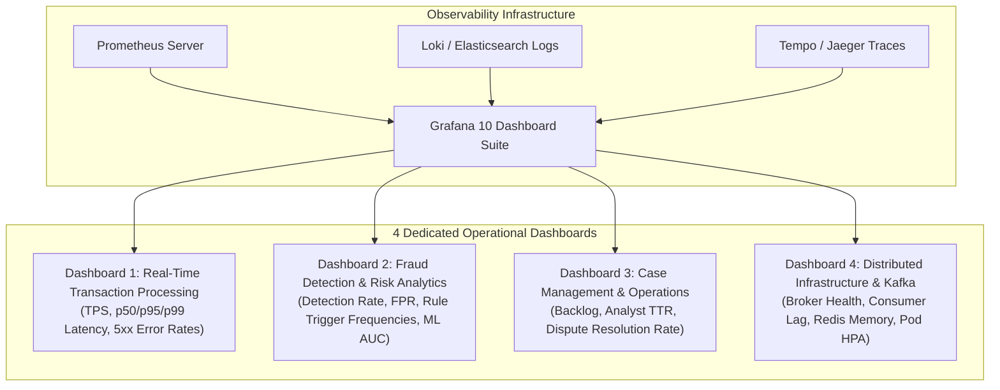

# Monitoring Dashboards, Prometheus Alerting Rules & Operational Runbooks

ShieldPay enforces deep observability using **Prometheus**, **Grafana**, **Alertmanager**, and automated operational runbooks to ensure 99.99% availability and sub-100ms response latencies.

---

## 1. The Four Production Grafana Dashboards

### Dashboard Specifications:
1. **Transaction Processing Dashboard**: Real-time throughput gauge (TPS), p50/p95/p99 latency heatmaps, HTTP status code distribution (2xx, 4xx, 5xx), channel breakdown (POS vs ECOM vs UPI).
2. **Fraud Detection Dashboard**: Total blocked fraud value (INR), live false positive rate trend line, top 10 triggered rules bar chart, ML anomaly score distribution histogram, Louvain graph community size distribution.
3. **Case Management Dashboard**: Open case queue count by priority (P1/P2/P3), active investigator utilization, mean time to investigate (MTTI), chargeback representment win rate.
4. **Infrastructure Dashboard**: Kafka consumer lag per partition, Redis hit/miss ratio, Neo4j memory pool allocation, Kubernetes CPU/Memory utilization vs requests/limits.

---

## 2. Severity-Based Alerting Routing (P1 to P4)

| Severity | Target SLA / Escalation | Notification Channel | Sample Alert Scenarios |
| :--- | :--- | :--- | :--- |
| **P1 - Critical** | **Ack < 5 min**; Page on-call immediately; auto-escalate to VP Eng after 15 min | PagerDuty voice call + SMS + `#incident-critical` Slack | - Transaction pipeline down / 5xx rate > 1% - Overall fraud detection rate drops < 80% - Kafka consumer lag > 50,000 messages on critical topic |
| **P2 - High** | **Ack < 30 min**; Escalate after 1 hour | Slack `#alerts-high` + PagerDuty push | - Pipeline p99 latency > 150ms for 5 minutes - Single detection engine fallback activated (ML or Graph down) - Redis memory utilization > 85% |
| **P3 - Medium** | **Review within 4 hours**; Business hours | Slack `#alerts-ops` + Daily Ops Digest Email | - False positive rate increased by 20% over 7-day baseline - Population Stability Index (PSI) > 0.25 (model drift) - Case management queue backlog > 500 cases |
| **P4 - Low** | **Weekly review** | Weekly Infrastructure Review Dashboard | - Disk usage > 70% on warm logging storage - Non-critical worker node cost anomalies |

---

## 3. Operational Incident Runbooks

### Runbook 1: P1 Alert - Critical Kafka Consumer Lag on `fraud.transactions.raw`
- **Symptoms**: Kafka consumer lag on `cg-rule-engine-evaluators` exceeds 10,000 messages; authorization latency spikes above 150ms.
- **Diagnosis**:
  1. Inspect Grafana Infrastructure Dashboard for node CPU/Memory saturation.
  2. Run `kubectl get hpa -n fraud-detection` to verify if pod autoscaler has reached max replica limit.
  3. Check Kafka topic partition skew: `kafka-consumer-groups.sh --describe --group cg-rule-engine-evaluators`.
- **Remediation**:
  1. Immediately scale evaluator deployment: `kubectl scale deployment rule-engine-service --replicas=32 -n fraud-detection`.
  2. If a single poison message is causing crash-looping, trigger DLQ bypass via admin CLI: `fraud-cli dlq skip --partition 
 --offset <O>`.
  3. Verify lag drops below 1,000 within 3 minutes.
- **Escalation**: If lag continues growing after 5 minutes, page the Secondary Platform Architect and initiate degraded mode.

### Runbook 2: P1 Alert - Detection Rate Drops Below 80%
- **Symptoms**: Automated 1-hour reconciliation indicates detection rate fell from 96% to 74%; sudden surge in fraud chargebacks reported by payment networks.
- **Diagnosis**:
  1. Check if a newly deployed rule version or model candidate was promoted in the last 2 hours.
  2. Check Anomaly Detection PSI metric for acute feature distribution shift.
  3. Check Graph Analysis service health and Neo4j connectivity.
- **Remediation**:
  1. Roll back recent rule version via Rule Management API: `POST /api/v1/rules/{id}/rollback`.
  2. If ML model is degraded, revert traffic split from Challenger back to Champion (100% Champion).
  3. Tighten rule engine base thresholds: lower amount limit for mandatory step-up authentication from ₹500,000 to ₹100,000 temporarily.
