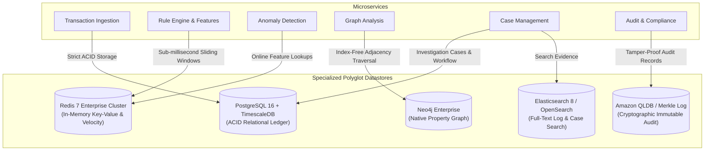

# Polyglot Persistence Strategy & Storage Architecture

In ShieldPay's modern microservices architecture, a single monolithic database (the legacy 45 TB Oracle 19c instance) is replaced with **Polyglot Persistence**, where each service selects the specialized database engine optimal for its read/write access patterns, consistency requirements, and latency SLAs.

---

## 1. Datastore Selection Matrix & Quantitative Justification

| Datastore | Primary Target Service(s) | Architectural Justification | Consistency Model | Scaling & High Availability | Backup & Retention |
| :--- | :--- | :--- | :--- | :--- | :--- |
| **PostgreSQL 16 Enterprise** (with TimescaleDB) | `transaction-ingestion-service`, `case-management-service` | Strict ACID guarantees for transactional financial state. Relational integrity for complex foreign keys (cases, chargebacks, customer links). TimescaleDB hypertable partitioning by timestamp guarantees blazing write throughput for ledger entries. | Strong Consistency (Synchronous commit to local replica) | Patroni cluster with 3 nodes (1 Leader, 2 Sync Replicas) + pgBouncer pool | Continuous WAL archiving to S3, daily full physical backups, PITR retention: 35 days |
| **Redis 7 Enterprise Cluster** | `rule-engine-service`, `reference-data-service`, `api-gateway` | Sub-millisecond read/write latency (\(< 1\text{ ms}\)). Native atomic operations (`INCR`, `EXPIRE`, sorted sets `ZADD`/`ZRANGEBYSCORE`) ideal for real-time velocity checking, rate limiting counters, and rule caching. | Strong for single keys; eventual across multi-region active-active CRDTs | Redis Cluster with 6 masters + 6 replicas across 3 AZs; in-memory persistence via AOF (every sec) | Daily RDB snapshots to object storage; in-memory TTL on temporary velocity keys |
| **Neo4j Enterprise Clustered** | `graph-analysis-service` | Native graph engine with index-free adjacency. Evaluates multi-hop relationship traversals (e.g., finding all cards sharing a phone number or IP subnet) in \(O(1)\) pointer chasing instead of expensive relational SQL table joins. | Causal Consistency (Raft-based core clustering) | 3 Core Members for Raft write quorum + 3 Read Replicas for high-throughput Cypher queries | Hot backups daily, Cypher dump, retention 180 days active (pruned afterwards) |
| **Amazon QLDB / Merkle Append-Only Log** | `audit-compliance-service` | Cryptographically verifiable transaction log. SHA-256 hash chaining ensures that any modification of an audit record invalidates the Merkle tree root, satisfying RBI and PCI DSS section 10 compliance. | Strong Append-Only Consistency | Multi-AZ distributed journal managed by AWS or self-hosted Raft-backed ledger | Infinite retention for audit events (7 years statutory requirement for RBI) |
| **Elasticsearch 8 / OpenSearch** | `case-management-service`, Centralized Logging | Inverted indexing for ultra-fast full-text search across analyst notes, merchant names, device identifiers, and distributed log traces. | Eventual Consistency (Refresh interval 1s) | 3 Master nodes + 6 Hot Data nodes + 6 Warm Data nodes | Daily index snapshots via ILM (Index Lifecycle Management) |

---

## 2. Velocity Tracking Storage Implementation: Redis Sliding Windows

To evaluate velocity rules (e.g., *"More than 5 transactions in 10 minutes from the same card"*), the system uses **Redis Sorted Sets (`ZSET`)**:
1. Key format: `velocity:card:<card_number_hash>:tx_count`
2. When a transaction occurs at epoch timestamp \(T\):
   - Add transaction ID to sorted set with score \(T\): `ZADD velocity:card:<hash>:tx_count <T> <tx_id>`
   - Evict transactions older than window (\(T - 600\text{ seconds}\)): `ZREMRANGEBYSCORE velocity:card:<hash>:tx_count -inf (T - 600)`
   - Count transactions remaining in window: `ZCARD velocity:card:<hash>:tx_count`
   - Set key expiration for automatic garbage collection: `EXPIRE velocity:card:<hash>:tx_count 600`
3. All operations run inside an atomic **Redis pipeline / Lua script**, completing in under **0.8 milliseconds**.
