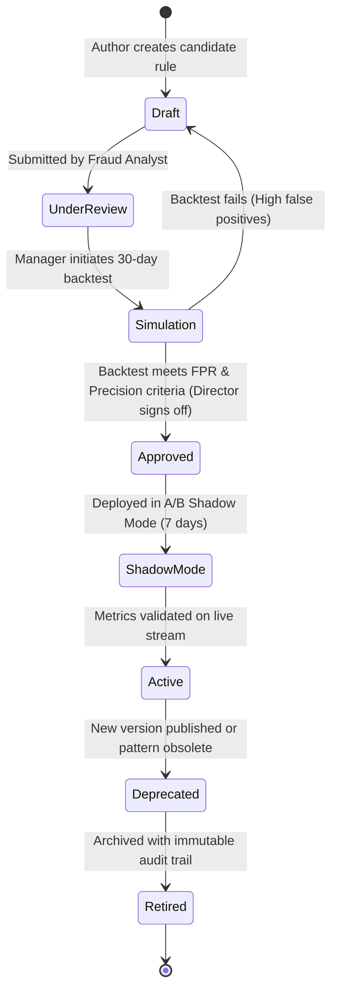

# Rule Engine Configuration Framework & Lifecycle Specification

## 1. Rule Engine Architecture

The `rule-engine-service` provides sub-25ms deterministic evaluation of business policies, compliance mandates, and velocity patterns across hundreds of rules.

---

## 2. Rule Lifecycle State Machine & Governance

1. **Draft**: Rule authored in YAML schema by Fraud Analyst.
2. **Under Review**: Risk Manager inspects condition logic, scopes, and performance impact.
3. **Simulation (Historical Backtest)**: Rule evaluated against 30 days of historical transactions (\(\approx 72\text{ million records}\)). Produces a backtest report:
   - Transactions evaluated
   - Transactions flagged
   - Detection Rate (Recall)
   - False Positive Rate (FPR)
   - Estimated annual fraud loss prevented (INR)
   - Estimated customer friction cost
4. **Approved**: Risk Director signs off with cryptographic audit confirmation.
5. **Shadow Mode (A/B Testing)**: Runs on 100% of live traffic in shadow mode for 7 days. Outputs are recorded, but do NOT modify the live authorization decision.
6. **Active**: Promoted to live evaluation. Evaluated with short-circuit prioritization.
7. **Deprecated & Retired**: Replaced by higher-version rules. Kept in immutable store for 7 years for regulatory re-simulation.

---

## 3. The 20 Production Sample Rules Across 7 Categories

Below is the complete inventory of the 20 production fraud detection rules implemented in `configs/rules.yaml`:

### Category 1: Velocity Checks (5 Rules)
1. `RULE_VEL_001`: Card Velocity Spike (> 5 transactions in 10 minutes on same card). Action: `SCORE_ADJUST +250`.
2. `RULE_VEL_002`: Rapid Multi-Merchant Fan-out (> 3 distinct merchants in 5 minutes). Action: `STEP_UP_AUTH`.
3. `RULE_VEL_003`: Extreme Velocity Surge (> 10 transactions in 60 minutes). Action: `FLAG` + `SCORE_ADJUST +350`.
4. `RULE_VEL_004`: Cumulative Amount Velocity (Total spend > ₹200,000 in 1 hour). Action: `STEP_UP_AUTH`.
5. `RULE_VEL_005`: UPI Collect Request Velocity (> 4 incoming UPI collect requests in 15 minutes). Action: `BLOCK`.

### Category 2: Amount Thresholds (3 Rules)
6. `RULE_AMT_001`: High-Value Domestic Transaction (> ₹500,000 INR). Action: `STEP_UP_AUTH` (Biometric / OTP).
7. `RULE_AMT_002`: High-Value International CNP (> ₹100,000 INR on foreign merchant). Action: `STEP_UP_AUTH`.
8. `RULE_AMT_003`: Statistical Outlier (> 5 standard deviations above 90-day cardholder mean). Action: `FLAG` + `SCORE_ADJUST +300`.

### Category 3: Geographic Anomalies (3 Rules)
9. `RULE_GEO_001`: Impossible Travel Velocity (Consecutive transactions in 2 countries with implied speed > 800 km/h). Action: `BLOCK`.
10. `RULE_GEO_002`: High-Risk Jurisdiction (Transaction originating from FATF blacklisted country). Action: `BLOCK`.
11. `RULE_GEO_003`: First-Time Foreign Country (First transaction outside home country without prior travel notice). Action: `STEP_UP_AUTH`.

### Category 4: Merchant Category Code (MCC) Restrictions (3 Rules)
12. `RULE_MCC_001`: First-Time Gambling MCC (Transaction at MCC 7995 without historical gambling profile). Action: `STEP_UP_AUTH` + `SCORE_ADJUST +200`.
13. `RULE_MCC_002`: Cryptocurrency Exchange Direct Debit (MCC 6051 single transaction > ₹50,000). Action: `STEP_UP_AUTH`.
14. `RULE_MCC_003`: Wire Transfer / Quasi-Cash Surge (MCC 4829 or 6050 > ₹150,000 in 24 hours). Action: `FLAG`.

### Category 5: Watchlist & Blacklist Matching (2 Rules)
15. `RULE_WCH_001`: Compromised Card PAN Match (Card hash listed on card brand breach notification bulletin). Action: `BLOCK`.
16. `RULE_WCH_002`: Malicious IP / Botnet Subnet Match (IP identified on real-time Threat Intelligence feed). Action: `BLOCK`.

### Category 6: Behavioural Anomalies (2 Rules)
17. `RULE_BEH_001`: Dormant Account Sudden High-Value Spike (No activity for 180 days, sudden transaction > ₹50,000). Action: `STEP_UP_AUTH`.
18. `RULE_BEH_002`: Witching Hour Anomaly (High-value CNP transaction between 02:00 AM and 04:30 AM local time). Action: `SCORE_ADJUST +150`.

### Category 7: Device & Network Risks (2 Rules)
19. `RULE_DEV_001`: Rooted / Jailbroken Device with Proxy (Jailbroken mobile OS + active VPN/TOR detected). Action: `BLOCK`.
20. `RULE_DEV_002`: Device Fingerprint Multi-Account Hopping (Device associated with > 5 different card accounts in 24 hours). Action: `BLOCK` + `FLAG`.
