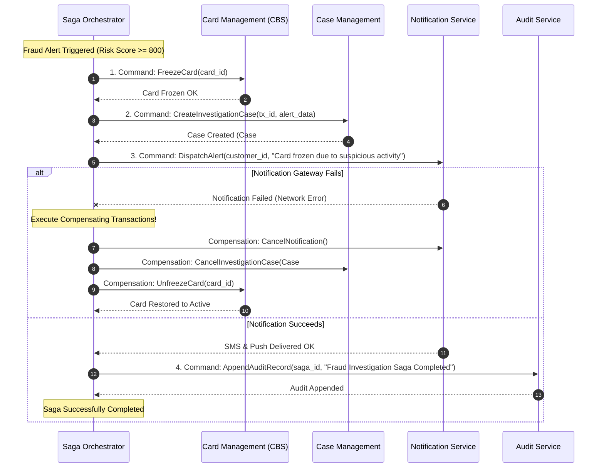
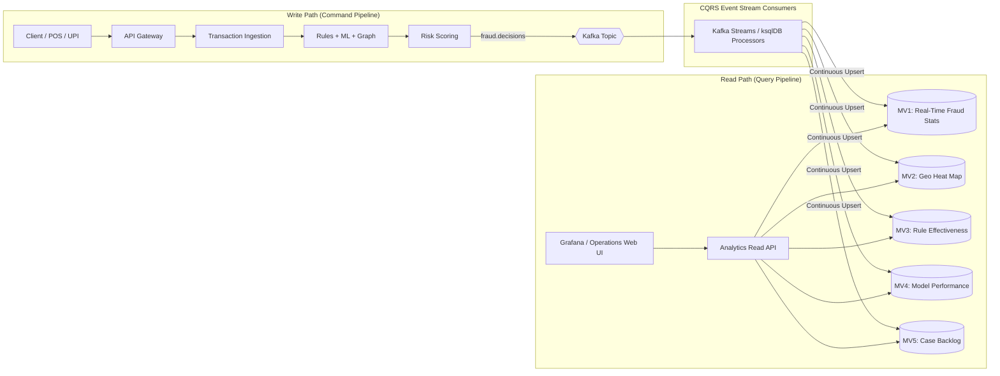

# Sagas, Distributed Consistency & CQRS Read Model Architecture

In a distributed microservices environment where two-phase commit (2PC) is rejected due to latency overhead and single points of failure, ShieldPay employs the **Saga Pattern** for distributed transactions and **Command Query Responsibility Segregation (CQRS)** to decouple real-time transaction processing from heavy analytics queries.

---

## 1. Saga Orchestration & Compensation Logic

ShieldPay deploys a dedicated **Saga Orchestrator** in `case-management-service` for complex multi-step workflows, utilizing orchestration to maintain central state visibility.

### Three Core Saga Workflows:

### 1. Transaction Processing Saga (Choreographed)
- **Step 1**: Ingestion receives payment -> Emits `TransactionReceived`.
- **Step 2**: Enrichment resolves IP/Device -> Emits `TransactionEnriched`.
- **Step 3**: Rule Engine, ML, Graph analyze concurrently -> Emit results.
- **Step 4**: Risk Scoring computes decision -> Emits `RiskDecisionComputed`.
- **Compensating Action**: If scoring fails or times out, a fallback decision (`STEP_UP_AUTH` with SMS OTP) is emitted; if downstream payment gateway rejects transaction, `TransactionReversed` is published to decrement velocity counters in Redis.

### 2. Fraud Investigation Saga (Orchestrated)
- **Step 1**: Card Management freezes card. *(Compensation: Unfreeze card)*
- **Step 2**: Case Management creates investigation case. *(Compensation: Mark case canceled)*
- **Step 3**: Notification Service alerts cardholder. *(Compensation: Send correction notification)*
- **Step 4**: Audit Service appends immutable log. *(No compensation needed - append-only)*

### 3. Card Blocking & Replacement Saga (Orchestrated)
- **Trigger**: Analyst marks case as `CONFIRMED_FRAUD`.
- **Step 1**: Card Management permanently cancels compromised card.
- **Step 2**: Core Banking orders physical/virtual replacement card with new PAN.
- **Step 3**: Customer Profile updates card status to `BLOCKED_FRAUD`.
- **Step 4**: Notification Service delivers replacement tracking number to cardholder.

---

## 2. CQRS Architecture & Materialized Views

### The 5 CQRS Materialized Views for Analytics Dashboard:

1. **`mv_realtime_fraud_statistics`**:
   - *Source*: Topic `fraud.decisions`.
   - *Aggregation*: Windowed counts of transactions processed, approved, challenged, declined, and fraud amount per minute, hour, day; grouped by channel (`POS`, `ECOM`, `UPI`) and card brand (`Visa`, `Mastercard`, `RuPay`).
   - *Sink*: Redis Timeseries / PostgreSQL Materialized Table. Query latency: **< 5 ms**.

2. **`mv_geographic_fraud_heatmap`**:
   - *Source*: Topics `fraud.transactions.enriched` and `fraud.decisions`.
   - *Aggregation*: Fraud attempt counts and total volume grouped by ISO-3166 country code, Indian state, and city geolocation coordinates, updated every 60 seconds.
   - *Sink*: Elasticsearch / OpenSearch geospatial index. Query latency: **< 15 ms**.

3. **`mv_rule_effectiveness_metrics`**:
   - *Source*: Topics `fraud.decisions` and `case.events`.
   - *Aggregation*: Per-rule statistics: total executions, trigger rate, true positives (confirmed fraud), false positives (analyst cleared), precision (\(TP / (TP + FP)\)), and evaluation latency.
   - *Sink*: PostgreSQL read replica. Query latency: **< 10 ms**.

4. **`mv_ml_model_performance`**:
   - *Source*: Topics `fraud.decisions` joined with 30-day chargeback lag labels.
   - *Aggregation*: Rolling AUC-ROC, Precision, Recall, F1 score, and scoring distribution percentiles for champion vs challenger models.
   - *Sink*: TimescaleDB analytics table. Query latency: **< 20 ms**.

5. **`mv_case_management_backlog`**:
   - *Source*: Topic `case.events`.
   - *Aggregation*: Open investigation cases grouped by priority (`P1_CRITICAL`, `P2_HIGH`, `P3_MEDIUM`), assigned analyst workload, SLA breach proximity countdown, and average time-to-resolution (TTR).
   - *Sink*: PostgreSQL 16 read replica. Query latency: **< 8 ms**.
