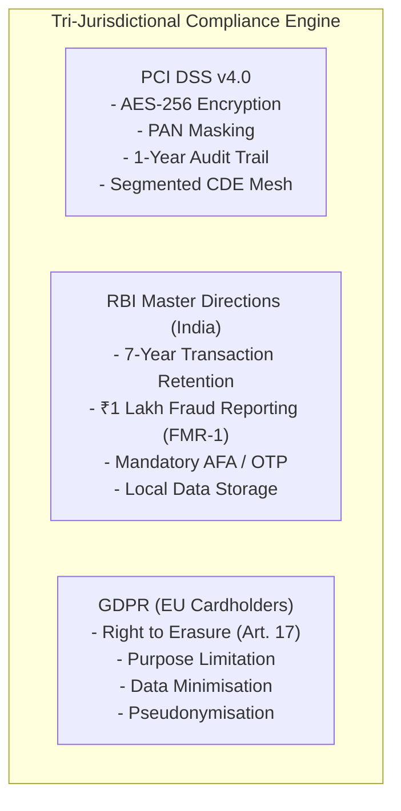

# Security, Service Mesh (Istio) & Regulatory Compliance Architecture

ShieldPay's architecture operates under a **Zero-Trust Network Architecture (ZTNA)**. Every microservice communication is cryptographically authenticated and encrypted using Istio service mesh mTLS, with strict role-based access control and comprehensive regulatory compliance across **PCI DSS v4.0, RBI Master Directions, and GDPR**.

```mermaid
graph TD
    subgraph ZeroTrustMesh["Istio Zero-Trust Service Mesh (Envoy Sidecars)"]
        GW[Edge API Gateway]
        TI[Transaction Ingestion Pod]
        RE[Rule Engine Pod]
        AD[Anomaly Detection Pod]
        GA[Graph Analysis Pod]
        RS[Risk Scoring Pod]
        NT[Notification Pod]
        AC[Audit & Compliance Pod]

        GW == Strict mTLS (TLS 1.3) ==> TI
        TI == Strict mTLS ==> RE
        TI == Strict mTLS ==> AD
        TI == Strict mTLS ==> GA
        RE == Strict mTLS ==> RS
        AD == Strict mTLS ==> RS
        GA == Strict mTLS ==> RS
        RS == Strict mTLS ==> NT
        RS == Strict mTLS ==> AC
    end

    NT -.x|AuthorizationPolicy BLOCKED| RE
    GA -.x|AuthorizationPolicy BLOCKED| NT

    subgraph SecurityVault["Key Management & Storage Security"]
        VAULT[HashiCorp Vault Enterprise]
        KMS[AWS / Hardware HSM KMS]
        VAULT <--> KMS
        VAULT -->|Dynamic Secrets & Certs| ZeroTrustMesh
    end
```

---

## 1. Service Communication Matrix & Istio Authorization Policies

ShieldPay implements the **Principle of Least Privilege (PoLP)** via Istio `AuthorizationPolicy` CRDs:

| Source Service (Caller) | Destination Service (Callee) | Allowed Methods / RPCs | Authorization Policy Rationale |
| :--- | :--- | :--- | :--- |
| `api-gateway` | `transaction-ingestion-service` | `POST /api/v1/transactions`, `GET /risk-score` | External traffic ingress point. |
| `transaction-ingestion` | `rule-engine-service` | gRPC `RuleEngineService.Evaluate` | Critical path scoring evaluation. |
| `transaction-ingestion` | `anomaly-detection-service` | gRPC `AnomalyDetectionService.Score` | Parallel ML inference path. |
| `transaction-ingestion` | `graph-analysis-service` | gRPC `GraphAnalysisService.AnalyseRelationships` | Parallel graph ring traversal. |
| `rule-engine-service` | `risk-scoring-service` | gRPC `RiskScoringService.SubmitRuleResult` | Emits per-rule flags & scores. |
| `anomaly-detection-service` | `risk-scoring-service` | gRPC `RiskScoringService.SubmitMLResult` | Emits anomaly likelihood score. |
| `graph-analysis-service` | `risk-scoring-service` | gRPC `RiskScoringService.SubmitGraphResult` | Emits ring & centrality scores. |
| `notification-service` | `*` (Any detection engine) | **BLOCKED (403 DENY)** | Notification service has no authorization to call fraud engines. |

---

## 2. Data Encryption & Key Management (PCI DSS v4.0)

1. **Cardholder Data at Rest (AES-256-GCM)**:
   - All PANs, expiration dates, and bank account identifiers are encrypted using AES-256 with Galois/Counter Mode (GCM) providing authenticated encryption.
   - Master Encryption Keys (MEK) reside inside FIPS 140-2 Level 3 Hardware Security Modules (HSMs).
   - Data Encryption Keys (DEK) are rotated automatically every 90 days via **HashiCorp Vault**.
2. **PAN Tokenisation & Masking**:
   - Primary Account Numbers are replaced at ingestion with surrogate format-preserving tokens (`tok_visa_4912xxxxxxxx1234`).
   - Plaintext PAN is never written to application logs, Kafka payloads, or monitoring spans. Display formats in the Case Management UI strictly mask characters: `4111-XXXX-XXXX-1111` (PCI DSS Req 3.4).
3. **Data in Transit (TLS 1.3 & mTLS)**:
   - External traffic terminates TLS 1.3 with high-grade cipher suites (`TLS_AES_256_GCM_SHA384`, `TLS_CHACHA20_POLY1305_SHA256`).
   - Internal inter-pod traffic enforces `PeerAuthentication` in `STRICT` mode with automated 24-hour mTLS certificate rotation handled by Istiod.

---

## 3. Tri-Jurisdictional Regulatory Compliance Framework

ShieldPay simultaneously complies with the divergent requirements of three major regulatory bodies:



### Resolving the RBI 7-Year Mandate vs. GDPR Right-to-Erasure Conflict:
- **The Conflict**: RBI mandates a statutory 7-year retention period for financial transaction records and fraud investigation evidence. In contrast, GDPR Article 17 grants European data subjects the "Right to Erasure" (Right to be Forgotten).
- **The Solution**: When an erasure request is validated for an EU cardholder:
  1. Personal identifiers (Name, Email, Phone, IP Address, Physical Address) are permanently wiped and replaced with irreversible cryptographic hashes in the active database.
  2. The financial audit ledger preserves the transaction amount, timestamp, merchant MCC, and risk decision tied to the pseudonymised entity hash.
  3. The cryptographic key used for the user's specific pseudo-token is permanently purged from HashiCorp Vault ("crypto-shredding"), making reverse identification mathematically impossible while retaining the immutable financial ledger required by banking regulators.
