# Service-Level Agreement (SLA) & Latency Budget Specification

## 1. End-to-End Latency Budget (Critical Path)

For live online payment authorizations (Card, POS, Net Banking, and UPI), the strict overall budget from API Gateway entry to decision emission is **100 milliseconds at p99**.

```mermaid
gantt
    title Critical Path Latency Budget (p99 Budget <= 100ms)
    dateFormat X
    axisFormat %s ms
    section Network & Gateway
    TLS Termination & Rate Limit Check : 0, 10
    section Ingestion
    Payload Validation & Normalisation : 10, 20
    section Parallel Fraud Engines
    Rule Engine Evaluation (Redis)    : 20, 45
    Anomaly Detection ML (ONNX)       : 20, 38
    Graph Analysis Query (Neo4j)      : 20, 60
    section Risk Decision
    Signal Aggregation & Scoring      : 60, 75
    Audit Logging & Response Dispatch : 75, 90
    Buffer for Network Jitter         : 90, 100
```

### Detailed Component Latency Breakdown:
- **API Gateway (Kong / Envoy)**: TLS 1.3 termination, JWT token validation, IP/Merchant Redis rate limiting check: **10 ms** (p99).
- **Transaction Ingestion Service**: JSON/ISO unmarshaling, card hash generation, preliminary sanity verification: **10 ms** (p99).
- **Parallel Evaluation Layer (Asynchronous Fan-out / Scatter-Gather via gRPC)**:
  - *Rule Engine*: Redis sliding window query + short-circuit condition evaluation: **25 ms** (p99).
  - *Anomaly Detection*: Feature retrieval from Redis Feature Store (5ms) + ONNX batch inference (12ms): **18 ms** (p99).
  - *Graph Analysis*: 2-hop neighborhood query on Neo4j read replica: **40 ms** (p99).
- **Risk Scoring Service**: Awaiting parallel engine outputs, weighted scoring aggregation, threshold classification, decision synthesis: **15 ms** (p99).
- **Response & Kafka Dispatch**: Asynchronous fire-and-forget Kafka event dispatch + client JSON serialization: **15 ms** (p99).
- **Safety Margin / Network Jitter**: **10 ms**.
- **Total Combined Latency Budget**: **100 ms**.

---

## 2. Microservice SLA Specification Matrix

| Service Name | p50 Latency | p95 Latency | p99 Latency | Availability Target | Max Target Throughput | Error Budget Policy | Upstream Dependencies |
| :--- | :--- | :--- | :--- | :--- | :--- | :--- | :--- |
| **API Gateway** | 3 ms | 7 ms | 10 ms | 99.99% | 20,000 TPS | Deployment freeze if error budget drops below 10% in 30-day window | Client Networks, DNS |
| **Transaction Ingestion** | 5 ms | 12 ms | 18 ms | 99.99% | 15,000 TPS | Automatic canary rollback if 5xx rate > 0.05% for 3 mins | Gateway, Kafka Broker |
| **Rule Engine** | 8 ms | 18 ms | 25 ms | 99.99% | 15,000 TPS | Fallback to base static safety rules if Redis cache fails | Ingestion, Redis Cluster |
| **Anomaly Detection** | 6 ms | 14 ms | 20 ms | 99.95% | 10,000 TPS | Degrade to Rule-only scoring if ML timeout exceeds 25ms | Redis Feature Store |
| **Graph Analysis** | 12 ms | 32 ms | 45 ms | 99.90% | 5,000 TPS | Score adjusted with safety penalty if graph lookup times out | Neo4j Read Cluster |
| **Risk Scoring** | 5 ms | 12 ms | 15 ms | 99.99% | 15,000 TPS | Short-circuit after 65ms total deadline | Rule, ML, Graph services |
| **Case Management** | 45 ms | 120 ms | 250 ms | 99.90% | 500 TPS | Non-critical path; standard business-hour SLA | PostgreSQL, Elastic |
| **Notification Service**| 250 ms | 1200 ms | 3000 ms| 99.90% | 2,000 TPS | Retry buffer in RabbitMQ; exponential backoff | Third-party SMS/Email gateways |
| **Audit & Compliance** | 15 ms | 40 ms | 80 ms | 99.99% | 15,000 TPS | Synchronous in-memory append with async disk sync to QLDB | Kafka `fraud.decisions` |

---

## 3. Error Budget & Cascading Failure Fallback Policies

1. **Rule Engine Fallback**: If the distributed Redis cluster experiences partition or elevated latency, the Rule Engine activates an in-process local LRU memory cache containing the top 50 critical hard-stops (e.g., card stolen, OFAC sanction match, transaction amount > ₹500,000).
2. **ML Model Timeout Policy**: The gRPC call from Risk Scoring to Anomaly Detection specifies a hard deadline of **25 milliseconds**. If ML prediction times out, Risk Scoring defaults ML contribution to a conservative median score (0.45) and logs an alert.
3. **Graph Analysis Degradation Policy**: If Neo4j traversals exceed the 45ms SLA, the transaction proceeds without graph signals, and a 10% risk margin is added to the composite score to prevent organized fraud rings from overwhelming the database to force approvals.
