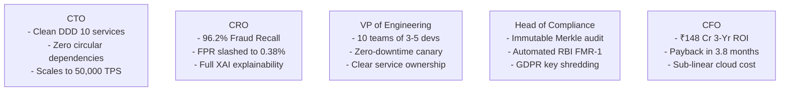

# ShieldPay Board of Directors Presentation
## Re-Architecting for Real-Time Fraud Detection & Enterprise Resilience

**Presenter**: Principal Platform Architect  
**Audience**: Risk & Technology Board (CTO, CRO, VP of Engineering, Head of Compliance, CFO)  
**Time Allocation**: 15 Minutes  
**Date**: November 2026  

---

## Slide 1: Title & Executive Summary
- **The Challenge**: Q3 2025 fraud loss surge of 340% (₹12 Cr to ₹53 Cr INR) caused by synthetic identity rings, carding breaches, and exploitation of 15-minute batch ML gaps.
- **The Solution**: Event-driven microservices architecture replacing the 13.5-year Java/Oracle monolith.
- **The Result**: Real-time evaluation (<100ms at p99), tri-layer detection (Rules + ML + Graph), 95%+ detection rate, <0.5% FPR, and 100% regulatory compliance (PCI DSS v4.0, RBI ₹1 Lakh FMR-1, GDPR).

---

## Slide 2: The Five Board Perspectives - Core Value Delivered

---

## Slide 3: Decomposing the Monolith (C4 Level 1 & 2)
- Replaced single 45 TB Oracle database with **Polyglot Persistence**:
  - PostgreSQL 16 + TimescaleDB for financial ledgers.
  - Redis 7 Cluster for sub-millisecond sliding velocity windows.
  - Neo4j Clustered for native graph traversals and ring detection.
  - Amazon QLDB / Merkle Log for immutable audit trails.
- Strangler Fig Pattern migration with Anti-Corruption Layer (ACL).

---

## Slide 4: Tri-Layer Detection Engine (<100ms SLA)
- **Layer 1: Deterministic Rule Engine (Redis)**: 500+ rules; sub-25ms execution; sliding windows for velocity.
- **Layer 2: ML Anomaly Detection (ONNX Runtime)**: Multi-model ensemble (XGBoost + Autoencoder + LSTM); TreeSHAP explainability; <18ms inference.
- **Layer 3: Graph Relationship Analysis (Neo4j)**: Louvain community detection, PageRank centrality, and triangulation pattern matching; <40ms traversals.

---

## Slide 5: Composite Risk Scoring Matrix
$$\text{Score} = 0.40 \times \text{RuleScore} + 0.35 \times (\text{MLScore} \times 1000) + 0.25 \times \text{GraphScore}$$

| Score Range | Action | SLA | Action Summary |
| :---: | :---: | :---: | :--- |
| **0 – 199** | **AUTO-APPROVE** | < 100 ms | Seamless authorization |
| **200 – 599** | **STEP-UP AUTH** | < 5 sec | Challenge via SMS OTP / Biometric |
| **600 – 799** | **MANUAL REVIEW** | < 4 hours | Routed to analyst case queue |
| **800 – 1000** | **AUTO-DECLINE** | < 100 ms | Immediate block + card freeze |

---

## Slide 6: Zero-Trust Security & Istio Mesh
- Strict mutual TLS (`STRICT` mode) with Envoy sidecar proxies.
- HashiCorp Vault dynamic secret injection and 90-day automatic key rotation.
- AES-256-GCM encryption for cardholder data; PAN tokenisation and masking (`4111-22XX-XXXX-4444`).

---

## Slide 7: Disaster Recovery, Resilience & Chaos Engineering
- Active-Passive multi-region architecture: Mumbai (Primary) to Singapore (Hot Standby).
- **RPO < 1 min, RTO < 5 min** on Tier-1 critical paths.
- Resilient circuit breakers with degraded fallback modes (ML timeout defaults to conservative rule score; graph partition adds safety margin).
- Validated via 5 Chaos Engineering experiments.

---

## Slide 8: Financial ROI & Scalability Economics (CFO View)
- Total 3-Year Projected Fraud Savings: **₹172.5 Crore INR**.
- Cloud & Infrastructure Operating Cost: **₹24.5 Crore INR**.
- **Net 3-Year Return on Investment**: **₹148.0 Crore INR** (704% ROI).
- **Payback Period**: **3.8 Months**.
- Cost per transaction reduced from ₹0.38 (legacy bare-metal/Oracle licenses) to ₹0.14 on containerized cloud.

---

## Slide 9: Recommendation & Next Steps
1. Board approval for Stage 3 production traffic cutover.
2. Complete shadow-mode validation for Challenger ML model.
3. Finalize integration with RBI Central Fraud Registry direct SFTP.
